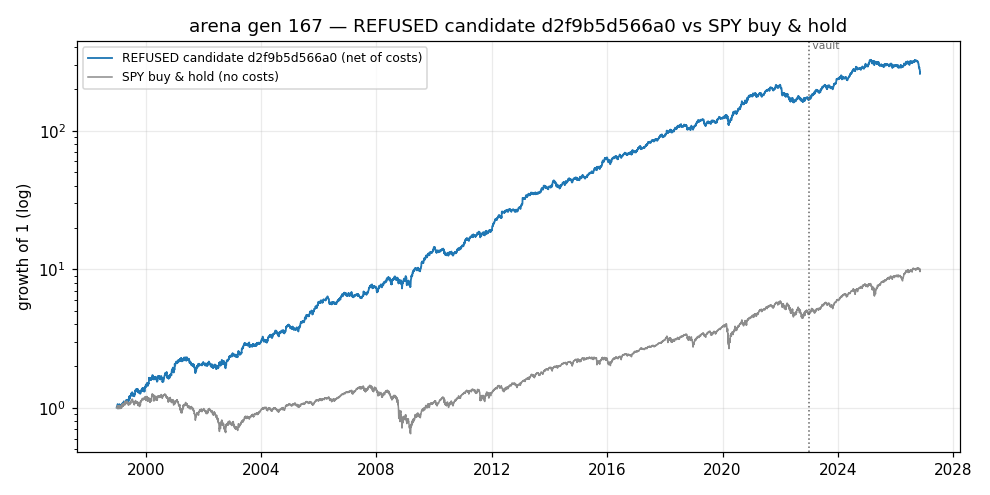
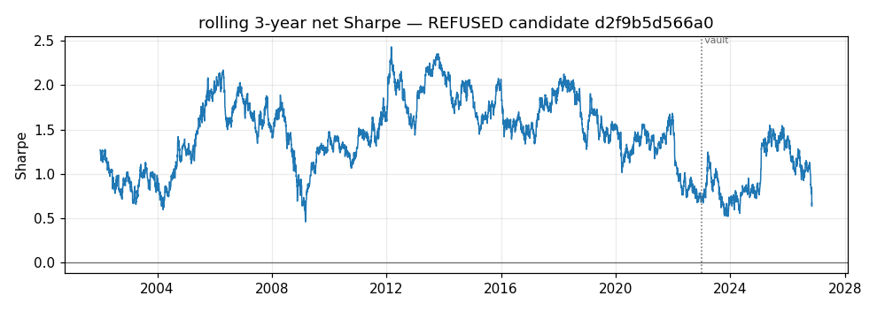
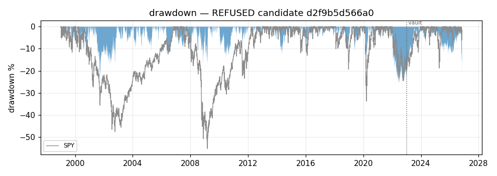

# arena — generation 167

**No champion.** Nothing has passed all ten promotion gates, so this system currently recommends nothing and holds nothing.

This report is about `d2f9b5d566a0`, the leading candidate of the last deep evaluation, **which the gates REFUSED** (failed G2+G3+G4). It is shown because a refusal with its numbers attached is more useful than a blank page — not because it is close to being a champion.

| | |
|---|---|
| data as of | 2026-11-06 |
| evaluation window | 1998-12-30 .. 2022-12-30 |
| vault window | 2023-01-03 .. 2026-11-06 |
| identity | data `370ebbb0afba6820` · panel `a36630a945d02221` · config `dd373ebf180943a7` |
| platform | x86_64linux (vendored siblings) |
| family | seasonal_rule |

## Equity, rolling Sharpe, drawdown

*Net equity against SPY buy-and-hold. The strategy line is net of every modelled friction; the benchmark line is not, which flatters the benchmark and is the harder comparison to win.*

*Rolling 3-year net Sharpe. Flat stretches below zero are what a single headline Sharpe hides.*

*Drawdown from the running peak, strategy and benchmark.*

*Everything left of the dotted vault line was available to selection; everything right of it was touched only by the promotion gates.*

## Headline numbers

| statistic | value |
|---|---|
| pre-vault net Sharpe | +1.366 |
| pre-vault days scored | 6041 |
| vault net Sharpe | +0.881 |
| vault days | 966 |
| Sharpe at 2x costs | +1.212 |
| bootstrap 95% CI of net Sharpe | [+0.995, +1.742] |
| CPCV paths net-positive | 100% of 28 (median path SR +1.24) |
| P(drawdown > 40% in 2 years) | 0.000 |

### Deflated Sharpe and PBO

- **DSR 0.0000 at N = 7537 ledger trials, 19 vault trials** (sr0 threshold 0.1615, T = 6041 days, skew 0.408, kurtosis 9.204). The deflation uses the EMPIRICAL spread of trial Sharpes from the ledger, never a hardcoded count.
- Vault DSR **0.8715** at N = 19 vault trials — the count of times any candidate has been shown the post-2023-01-01 data at all.
- **PBO n/a** (CSCV, d2f9b5d566a0 is not one of the 32 genomes in the generation-167 returns matrix, so that cohort's PBO is not evidence about it) — **this candidate is not in the cohort matrix, so PBO is unmeasured and gate G4 fails on that alone.**
- DSR is an OPTIMISTIC correction here: evolutionary trials are correlated, and correlated trials deflate less than independent ones would. The vault and the paper stage sit above it for exactly that reason.

## The ten promotion gates

| gate | what it asks | value | threshold | |
|---|---|---|---|---|
| G1 | like-for-like | 370ebbb0afba6820 / a36630a945d02221 / dd373ebf180943a7 | complete identity | PASS |
| G2 | DSR (pre-vault) | 0.000 | 0.950 | **FAIL** |
| G3 | vault confirmation | 0.881 / 0.872 | 0.000 / 0.900 | **FAIL** |
| G4 | PBO (CSCV) | n/a | 0.200 | **FAIL** |
| G5 | CPCV 28 paths | 1.000 / 1.245 | 0.700 / 0.300 | PASS |
| G6 | bootstrap Sharpe CI | 0.995 | 0.000 | PASS |
| G7 | 2x cost stress | 1.212 / 0.887 | 0.000 / 0.500 | PASS |
| G8 | regime slices | -0.209 / 3 | -0.300 / 3 | PASS |
| G9 | beats incumbent | n/a | 0.000 | PASS |
| G10 | ruin MC | 0.000 | 0.050 | PASS |

Deep-eval history row: promoted=0, candidates evaluated=2, gates failed=G2+G3+G4, complete=1.

*All ten must pass; ties go to the incumbent. A single failure is a refusal, and a refusal is the system working.*

## Crisis regimes (gate G8)

| window | net return | days | |
|---|---:|---:|---|
| 2000-03-01 .. 2002-10-31 | +33.9% | 671 |  |
| 2008-09-01 .. 2009-03-31 | +4.4% | 146 |  |
| 2020-01-01 .. 2020-06-30 | +10.0% | 125 |  |
| 2022-01-01 .. 2022-12-31 | -20.9% | 251 | under the soft floor (-5%) |

*Windows are drawdown LEGS — peak to trough, not peak to recovery. A window containing the rebound measures the wrong thing: 2008-01..2009-12 comes out positive for a book that was destroyed in the autumn of 2008.*

## Costs

- Gross cumulative return **+30258.6%**, net **+16717.5%** over 6041 pre-vault days.
- Cost drag **247 bps/year** of equity; mean daily turnover **17.3%** of equity.
- Total frictions paid: **$554,400** on a $15,000 account.
- **Cost share of gross: 9.8%**

## Trial ledger

- **7537 distinct genomes** have been evaluated at some fidelity and are on the ledger. That is the N every deflated Sharpe above is deflated by.
- **19 vault accesses** logged. Every look at post-2023-01-01 data is counted, including the ones that only stored an artifact.
- Screens count as trials. They exert selection pressure, so excluding them would make every DSR on this page optimistic.

## Hall of fame (top 10, pre-vault and ungated)

| # | genome | family | pre-vault SR | gen | born | op | parent |
|---|--------|--------|-------------:|----:|-----:|----|--------|
| 1 | `d2f9b5d566a0` | seasonal_rule | +1.480 | 152 | 152 | mutate | `2149d9e2cddf` |
| 2 | `1d0b9e9e34bd` | seasonal_rule | +1.476 | 152 | 151 | elite | `88f107cbf189` |
| 3 | `235dcadbd12d` | seasonal_rule | +1.476 | 152 | 152 | crossover | `9fd92547872c` x `235dcadbd12d` |
| 4 | `b2f25a455c8c` | seasonal_rule | +1.468 | 123 | 123 | mutate | `9519a24196a6` |
| 5 | `62c7ee522f7d` | seasonal_rule | +1.457 | 152 | 152 | mutate | `d9421c5225bf` |
| 6 | `862988250245` | seasonal_rule | +1.409 | 155 | 155 | crossover | `9b6fc97cce2c` x `9b6fc97cce2c` |
| 7 | `98404cdf0cb5` | seasonal_rule | +1.409 | 158 | 158 | mutate | `bb7e0dac4bac` |
| 8 | `ba90ce6f4ef3` | seasonal_rule | +1.409 | 158 | 158 | mutate | `e5056806d4d7` |
| 9 | `9a0f1aead193` | seasonal_rule | +1.364 | 166 | 165 | elite | `9d51be43864c` |
| 10 | `15f70771bf6d` | seasonal_rule | +1.342 | 167 | 166 | elite | `13887b0746b8` |

*Lineage columns are how a genome got here: which operator made it, from which parent, in which generation.*

## Simulation vs paper trading

**Paper trading has not started.** The graduation rule is three consecutive weekly deep evals kept by the same champion (docs/DESIGN.md, "Graduation ladder"); there is no champion at all. Until then every number in this report is a simulation of the past, and the sim-vs-realised overlay this section will hold does not exist.

---

## Limitations — read these with every number above

- **Survivorship bias.** The universe is a snapshot of today's index membership,
  so every company that failed out of it is absent from all of these backtests:
  long results come out optimistic and short results pessimistic. Disclosed, not
  solved; delisted-inclusive (CRSP-class) data is the named upgrade path.
- **Non-stationarity.** 1990s microstructure is simulated with modern costs, and
  a decades-old edge may simply have been arbitraged away since. The vault, the
  regime gate and the paper stage are defenses, not proofs.
- **Multiple testing survives the gates.** Evolutionary trials are correlated, so
  the ledger DSR under-deflates; PBO does not cover designer-level choices at all.
  The only accumulating true out-of-sample is vault -> paper -> live.
- **Small-account sensitivity.** The $1 minimum commission and whole-share
  rounding are 5-10 bps each way on small positions; the 2x cost-stress gate and
  the cost-share line above are what keep that visible.
- **The cost model is proportional (bps), not per-share.** Prices are
  split-adjusted, so a $/share friction would silently become hundreds of bps on
  1990s adjusted prices. Real 1990s spreads were wider than modern bps: any edge
  that survives only at modern costs is suspect by construction.

**Survivorship: the universe is today's S&P 500 membership, so long results flatter and short results understate.**

**Backtest alpha is a claim about the past, not a guarantee — not financial advice.**
